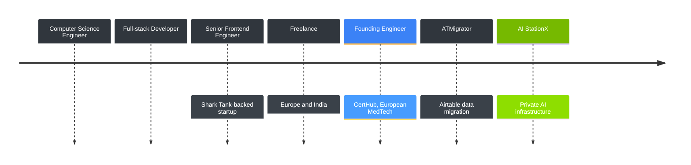

# Saud Chougle

### Private AI infrastructure · Local LLMs on NVIDIA hardware

I build AI systems that run on your own GPUs, with your data staying on your machines.

---

### What I do

- Deploy and tune open-source LLMs on NVIDIA GPUs
- Run multiple specialised models side by side behind one gateway
- Size GPUs, quantization and context for real users, measured, not guessed
- Build RAG and agent systems that answer from your own sources
- Make setups that rebuild the same way on any server, including air-gapped

### Stack

### Journey

---

**Working on local AI? Happy to talk through your setup.**

